# 第二部分 寰枢关节紊乱模型大鼠的血压及交感相关变化

寰枢关节结构异常与血压变化之间的联系具有实验研究价值。已有动物研究通过关节间隙置入固定物观察到血压升高，取出固定物后血压下降，为研究颈部结构变化与心血管调节的关系提供了模型基础[1]。不过，局部结构异常是否通过颈上神经节（superior cervical ganglion，SCG）及延髓头端腹外侧区（rostral ventrolateral medulla，RVLM）影响交感输出，仍需要直接的神经功能和干预证据。

本研究观察寰枢关节间隙异物置入及外科取出异物后大鼠的血压变化，并检测心率及心率变异性、血清递质与氧化应激相关指标，以及RVLM区域AT1R、NOX1、NOX4、RhoA、ROCK1和ROCK2的表达。研究重点是比较三组的表型与分子变化，并评估这些结果对交感相关机制假说的支持程度。

## 1 材料与方法

### 1.1 实验动物

健康清洁级雄性Wistar大鼠50只，约3月龄，体质量（250±10）g，购自安徽医科大学实验动物中心，实验动物生产许可证号为SCXK（皖）2017-001。大鼠分笼饲养，室温（22±1）℃，相对湿度约60%，自然光照，自由摄食及饮水，适应性饲养1周。实验动物处置遵循《关于善待实验动物的指导性意见》。

采用随机数字表法从50只大鼠中选取10只作为伪手术组，其余40只用于模型制备。复位组来源于成功造模的动物。血压结果按其观测样本数列示；血清检测每组8只，RT-qPCR每组6只，Western blot每组3只。

### 1.2 模型制备与异物取出

实验前采用无创尾动脉血压测量系统测定血压，按实验筛选标准排除尾动脉血压≥120 mmHg的大鼠。模型制备参考既往寰枢关节间隙固定物置入方法[1]，并采用S形金属固定物。大鼠称重后，腹腔注射3%苯巴比妥钠，剂量3 mg/100 g。麻醉后仰卧固定，剃除颈部毛发，碘伏消毒。经颈前部纵行切口逐层分离组织，暴露左侧寰枢关节；将头部向右旋转，在左侧寰枢椎间隙置入消毒后的S形金属固定物。确认固定后缝合切口，术后给予青霉素预防感染3 d。

伪手术组接受相同入路、组织分离及缝合处理，但不置入固定物。造模后7、14、21和28 d测量尾动脉血压并进行影像观察。造模后28 d，从固定物仍在位且血压升高的动物中选取复位组，接受第二次手术。腹腔注射10%水合氯醛，剂量0.3 mL/100 g；经原入路暴露关节，取出固定物并缝合，术后给予青霉素3 d。本文“复位”指外科取出固定物的处理。

### 1.3 血压与心电信号采集

伪手术组和模型组分别在术前及术后7、14、21、28 d，于固定时间采用IITC Life Science无创血压系统测量尾动脉血压。复位组在造模后28 d取出固定物，分别于取出后7、14、21、28 d测量。造模后的观察时间与异物取出后的观察时间分别记录。

心电信号采用PowerLab 8生理记录仪采集，采集时间为上午9:00—11:00，室温（25±2）℃。大鼠经3%苯巴比妥钠腹腔麻醉后仰卧固定，右上肢接负极，左下肢接正极，右下肢接地线。采用Chart 5软件，以100 Hz采样率连续采集10 min相对稳定的心电信号，选取其中5 min进行心率及心率变异性（heart rate variability，HRV）分析。

时域指标包括正常R-R间期的标准差（SDNN）和相邻正常R-R间期差值的均方根（RMSSD）；频域指标包括总功率（TP）及低频与高频功率比值（LF/HF）。原分析采用LF 0.04—0.15 Hz、HF 0.15—0.40 Hz。频段设置、麻醉状态和采样率对大鼠HRV的解释具有影响，因此频域结果仅作为该分析条件下的描述性指标。

### 1.4 血清递质及氧化应激相关指标

实验终点每组取8只大鼠，经腹主动脉采血，离心分离血清，分装后于−80℃保存。采用相应检测试剂盒测定去甲肾上腺素（norepinephrine，NE）、乙酰胆碱（acetylcholine，ACh）、血管紧张素Ⅱ（angiotensin II，AngⅡ）及血管紧张素（1—7）〔Ang（1—7）〕。采用酶标法读取吸光度，并根据各试剂盒的标准曲线和稀释倍数计算浓度。

氧化应激相关检测包括超氧化物歧化酶（superoxide dismutase，SOD）活性、丙二醛（malondialdehyde，MDA）及活性氧（reactive oxygen species，ROS）相关荧光信号。SOD反映抗氧化酶活性，MDA用于评价脂质过氧化，ROS荧光检测反映探针反应信号，三者的量纲分别表述。ROS检测采用血清100 μL与探针10 μL混合，37℃避光孵育15—30 min后读取荧光。

表1 血清检测主要试剂

| 检测项目 | 货号 | 生产厂家 |
| --- | --- | --- |
| AngⅡ | JYM0668Ra | 上海源叶生物科技有限公司 |
| NE | JYM0587Ra | 上海源叶生物科技有限公司 |
| ACh | JYM0422Ra | 上海源叶生物科技有限公司 |
| Ang（1—7） | JYM0827Ra | 上海源叶生物科技有限公司 |
| 总SOD | A001-3 | 南京建成生物工程研究院 |
| MDA | A003-1 | 南京建成生物工程研究院 |
| 血清ROS相关荧光检测 | 475015 | 上海贝博生物 |

### 1.5 RVLM区域基因表达检测

采用逆转录实时荧光定量PCR（RT-qPCR）检测RVLM区域AT1R、NOX1、NOX4、RhoA、ROCK1和ROCK2的表达，β-actin作为内参。每组6只独立大鼠，各动物各指标测定1次；靶基因与β-actin的Ct值按同一动物配对。

组织经TRIzol裂解，采用氯仿分相、异丙醇沉淀及75%乙醇洗涤获得总RNA。RNA溶于无RNA酶水，经基因组DNA去除和反转录获得cDNA。荧光定量PCR采用SYBR Green体系，在PIKOREAL 96荧光定量PCR仪上进行。10 μL反应体系包括2×SYBR Green混合液5 μL、正向引物及反向引物各1 μL（10 μmol/L）、cDNA 1 μL和无RNA酶水2 μL。反应条件为95℃预变性1 min，随后95℃20 s、60℃1 min，共40个循环。

表2 RT-qPCR引物序列

| 指标 | 产物长度 bp | 正向引物 5′至3′ | 反向引物 5′至3′ |
| --- | --- | --- | --- |
| β-actin | 150 | CCCATCTATGAGGGTTACGC | TTTAATGTCACGCACGATTTC |
| AT1R | 99 | CTGGCATTTTGTCTGGAT | TTTTCTGGGTTGAGTTGG |
| NOX1 | 84 | GCTCCAGACCTCCATTTG | CAGCCCCAACCAAGAAAC |
| NOX4 | 95 | GGGTTAAACACCTCTGTC | GTAGTATTCTGGCCCTTG |
| RhoA | 88 | GTTTATGTGCCCACGGTGTT | CAGCTGTGTCCCATAAAGCC |
| ROCK1 | 150 | TCACAAGTAGCAGCATCA | CAGGAAAATCCAAATCAT |
| ROCK2 | 95 | GTCAGAGGAAGCTGGAGG | CAAATCAAGGACCAAGGA |

在目标基因与内参扩增效率相同且近似100%的假设下，采用Ct差值换算相对表达[2]。每只大鼠的ΔCt为靶基因Ct减去其配对β-actin Ct；按Q=2的负ΔCt次幂将该差值换算为相对数量，再除以伪手术组Q的算术均值。所得归一化表达量用于绘制或汇总描述性结果，伪手术组表达量的算术均值为1。

### 1.6 RVLM区域蛋白表达检测

采用Western blot检测AT1R、NOX1、NOX4、RhoA、ROCK1和ROCK2，每组3只独立大鼠，β-actin作为上样参照。组织加入含PMSF的RIPA裂解液匀浆，离心后收集上清，与上样缓冲液混合，沸水浴10 min变性。采用SDS-PAGE分离蛋白后转移至PVDF膜，以5%脱脂奶粉室温封闭2 h，4℃孵育一抗过夜，洗膜后孵育HRP标记二抗，采用ECL化学发光检测。

表3 Western blot主要一抗

| 抗体 | 厂家 | 货号 | 一抗稀释比例 | 标示分子量 kDa |
| --- | --- | --- | --- | --- |
| β-actin | Zsbio | TA-09 |  | 42 |
| AT1R | Bioss | bs-0630R | 1∶1000 | 39 |
| NOX1 | Bioss | bs-3682R | 1∶1000 | 62 |
| NOX4 | Bioss | bs-1091R | 1∶1000 | 64 |
| RhoA | Abcam | ab187027 | 1∶5000 | 22 |
| ROCK1 | Bioss | bs-1166R | 1∶1000 | 158 |
| ROCK2 | Bioss | bs-1205R | 1∶1000 | 161 |

Western blot结果展示三组代表性条带。条带信号用于观察蛋白免疫反应的相对趋势；蛋白表达的定量比较应建立在各独立动物的目标蛋白和上样参照信号均处于线性检测范围的基础上。

### 1.7 组织形态与AT1R免疫染色

采用石蜡切片进行HE染色、AT1R免疫组化及免疫荧光观察。HE切片经二甲苯脱蜡、梯度乙醇复水后，以苏木素染色、盐酸酒精分化及返蓝，再行伊红染色、脱水、透明和封片。免疫荧光切片脱蜡复水后进行抗原修复和山羊血清封闭，孵育一抗及荧光二抗，DAPI复染后以抗荧光淬灭封片液封片，采用荧光显微镜观察。

结果展示代表性切片及其原有比例尺。AT1R免疫反应信号与DAPI核染色分别观察；AT1R单标记的信号分布不作为神经元身份或神经元数量的判定依据。

### 1.8 数据整理与统计分析

血压、心率、HRV及血清指标以均数±标准差作描述性汇总。造模后与异物取出后的血压分别按各自时间轴展示，避免将不同实验阶段作为同一时点直接比较。

对RT-qPCR原始Ct进行回顾性重分析，以独立大鼠为统计单位，每组n=6。对每只大鼠按配对Ct计算ΔCt，归一化表达量以算术均数±样本标准差表示。各靶标的三组两两比较均对ΔCt采用双侧Welch t检验，以适应可能存在的组间方差差异。六个靶标各进行三次比较，共18次检验，采用Holm法对全部18个P值统一校正，以调整后P<0.05为统计学差异标准。表达量比值与ΔCt尺度的差异共同用于解释结果。

统计计算采用Python 3及SciPy 1.18.1完成，Welch检验结果由均值和方差公式交叉核对。统计检验只用于具有逐动物Ct记录的RT-qPCR结果。血压、HRV、血清指标及Western blot在本节作描述性呈现，不据汇总数值或代表性图片新增显著性结论。小样本RT-qPCR的检验结果仍需结合扩增效率、特异性、内参稳定性及异常值核查判断。

## 2 结果

### 2.1 造模及异物取出后的血压变化

伪手术组和模型组的术前尾动脉血压分别为（101.0±12.2）和（103.5±11.5）mmHg。模型组在置入异物后的观察期内，血压均值由第1周的122.2 mmHg逐步升至第4周的147.1 mmHg；伪手术组第4周为114.5 mmHg。两组第4周均值相差32.6 mmHg（表4）。

表4 伪手术组与模型组造模观察期尾动脉血压 mmHg

| 组别 | n | 术前 | 术后7 d | 术后14 d | 术后21 d | 术后28 d |
| --- | --- | --- | --- | --- | --- | --- |
| 伪手术组 | 10 | 101.0±12.2 | 102.3±7.3 | 107.2±6.1 | 110.4±7.3 | 114.5±7.2 |
| 模型组 | 19 | 103.5±11.5 | 122.2±18.1 | 123.9±11.9 | 135.1±15.0 | 147.1±10.6 |

复位组在取出固定物后的血压均值由第1周的138.0 mmHg下降至第4周的100.0 mmHg（表5）。该变化显示异物取出后血压呈下降趋势。复位组的时间轴始于第二次手术，不能将其第1—4周与造模组术后第1—4周视为相同年龄或病程下的横向比较。

表5 复位组异物取出后尾动脉血压 mmHg

| 组别 | n | 取出后7 d | 取出后14 d | 取出后21 d | 取出后28 d |
| --- | --- | --- | --- | --- | --- |
| 复位组 | 8 | 138.0±18.1 | 120.0±11.9 | 110.0±15.0 | 100.0±10.6 |

注：表4、表5分别呈现两阶段的描述性汇总；组间及个体内变化的推断需采用与观察设计对应的分析。

### 2.2 心率及心率变异性

模型组心率均值为356次/min，高于伪手术组的302次/min和复位组的299次/min。模型组SDNN、RMSSD及TP的均值低于伪手术组，LF/HF均值较高。复位组SDNN、RMSSD及TP均值高于模型组，但LF/HF均值仍较高，且两组该指标的标准差较大（表6）。这些结果应分别按时域和频域指标描述，不能概括为模型组“HRV整体增高”或复位后自主神经功能“完全恢复”。

表6 三组大鼠心率及HRV描述性结果

| 组别 | HR 次/min | SDNN | RMSSD | TP | LF/HF |
| --- | --- | --- | --- | --- | --- |
| 伪手术组 | 302±114 | 38.84±28.74 | 54.75±42.22 | 2051±2795 | 0.49±0.14 |
| 模型组 | 356±40 | 19.41±23.05 | 23.04±28.72 | 312±479 | 3.38±6.36 |
| 复位组 | 299±56 | 32.55±22.10 | 34.89±29.28 | 1181±1444 | 3.00±5.36 |

注：LF/HF为无量纲比值。频域结果限于方法所述的原分析频段。

### 2.3 血清递质与血管紧张素

模型组血清ACh均值低于伪手术组，AngⅡ均值高于伪手术组；复位组ACh均值高于模型组，AngⅡ均值低于模型组。模型组NE及Ang（1—7）的均值也较高，但组内离散程度较大，不能据均值大小直接认定交感活性或相关通路增强（表7）。

表7 三组大鼠血清递质及血管紧张素 pg/mL

| 组别 | n | NE | ACh | AngⅡ | Ang（1—7） |
| --- | --- | --- | --- | --- | --- |
| 伪手术组 | 8 | 118.44±64.93 | 136.61±22.71 | 136.94±16.91 | 14.16±7.93 |
| 模型组 | 8 | 240.10±179.59 | 55.53±5.04 | 491.84±90.58 | 35.55±27.39 |
| 复位组 | 8 | 94.68±104.58 | 83.93±12.46 | 189.77±34.12 | 12.50±11.55 |

### 2.4 血清氧化应激相关指标

模型组SOD活性的汇总数值低于伪手术组，而MDA与ROS相关荧光信号高于伪手术组。复位组SOD活性数值高于模型组，MDA与ROS相关荧光信号低于模型组，但其均值未完全达到伪手术组水平（表8）。整体变化方向提示异物置入伴随氧化应激相关指标改变，取出异物后部分指标呈回落趋势。

表8 三组大鼠血清氧化应激相关指标

| 组别 | SOD活性 | MDA nmol/mL | ROS相关荧光信号 |
| --- | --- | --- | --- |
| 伪手术组 | 19.253±1.319 | 0.956±0.852 | 18949±1080 |
| 模型组 | 5.665±1.992 | 3.706±0.803 | 30203±1834 |
| 复位组 | 13.756±3.791 | 2.059±1.166 | 24301±1779 |

注：SOD为酶活性指标，ROS为荧光读数，二者不统一使用MDA的浓度单位。血清指标反映外周样本变化，不能直接代表RVLM局部ROS生成量。

### 2.5 RVLM区域基因表达

按逐动物配对Ct重新归一化后，模型组AT1R、NOX1、NOX4、RhoA、ROCK1和ROCK2的表达量均高于伪手术组，全部六项比较的Holm调整后P<0.05。复位组AT1R、NOX1、NOX4、RhoA及ROCK1较模型组降低，调整后P<0.05；ROCK2均值也较低，但未达到校正后的显著性（调整后P=0.061800）。复位组与伪手术组比较，除NOX1未达到校正后显著性（调整后P=0.061800）外，其余五项表达量仍较高（表9、表10）。

模型组归一化表达量的算术均值依次约为伪手术组的2.98、1.46、2.90、1.48、3.74和2.84倍。上述结果显示六项转录本丰度均有变化，异物取出后多数指标降低，但不能将非显著差异解释为已恢复或与对照等效。

表9 三组大鼠RVLM区域归一化基因表达量

| 指标 | 伪手术组 n=6 | 模型组 n=6 | 复位组 n=6 |
| --- | --- | --- | --- |
| AT1R | 1.000±0.324 | 2.976±0.524 | 1.742±0.348 |
| NOX1 | 1.000±0.134 | 1.459±0.156 | 1.180±0.090 |
| NOX4 | 1.000±0.233 | 2.902±0.558 | 1.645±0.227 |
| RhoA | 1.000±0.098 | 1.480±0.123 | 1.237±0.039 |
| ROCK1 | 1.000±0.064 | 3.745±0.690 | 1.880±0.105 |
| ROCK2 | 1.000±0.165 | 2.843±0.288 | 2.163±0.490 |

注：每组6只独立大鼠，各测1次；均数±样本标准差。每只大鼠靶基因Ct按其配对β-actin Ct归一化；相对数量除以同一靶标伪手术组的算术均值。表内数值建立在相同且近似100%扩增效率的假设下。

表10 RT-qPCR两两比较的Holm调整后P值

| 指标 | 模型组与伪手术组 | 复位组与模型组 | 复位组与伪手术组 |
| --- | --- | --- | --- |
| AT1R | 0.002463 | 0.004666 | 0.024669 |
| NOX1 | 0.003713 | 0.013898 | 0.061800 |
| NOX4 | 0.000102 | 0.003713 | 0.009897 |
| RhoA | 0.000376 | 0.013898 | 0.012943 |
| ROCK1 | <0.0001 | 0.002867 | <0.0001 |
| ROCK2 | <0.0001 | 0.061800 | 0.002867 |

注：双侧Welch t检验作用于逐动物ΔCt；Holm调整涵盖六个靶标的全部18次比较。P值反映ΔCt差异的统计证据，不等同于蛋白活性或神经放电的改变。

### 2.6 RVLM区域Western blot代表性条带

三组代表性条带中，AT1R、NOX1、NOX4、RhoA、ROCK1和ROCK2的模型组泳道信号整体较深，复位组部分条带信号低于模型组（图1）。该观察为图片层面的趋势，不赋予其动物间蛋白定量或统计显著性的含义。β-actin的信号较强，目标蛋白与内参的曝光线性范围需共同考虑。

β-actin

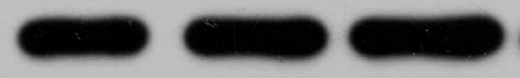

AT1R

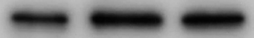

NOX1

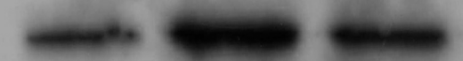

NOX4

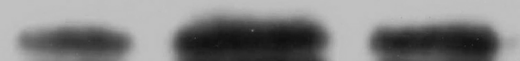

RhoA

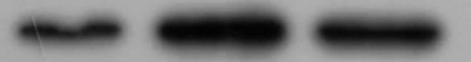

ROCK1

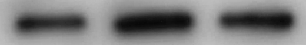

ROCK2

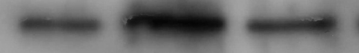

图1 三组大鼠Western blot代表性条带

注：泳道自左至右为伪手术组、模型组、复位组。β-actin为上样参照。图示保留各条带原图的灰度、裁剪范围及相对显示顺序，标示分子量沿用原图信息；代表性泳道不等于每组独立动物数。

### 2.7 组织形态及AT1R免疫反应分布

三组HE代表性切片见图2，AT1R免疫组化代表性图像见图3。HE图像用于观察组织基本形态，免疫组化图像中可见棕色免疫反应信号。组织形态和染色信号的视觉差异不直接作为炎性细胞计数、神经元减少或尼氏体变化的定量依据。

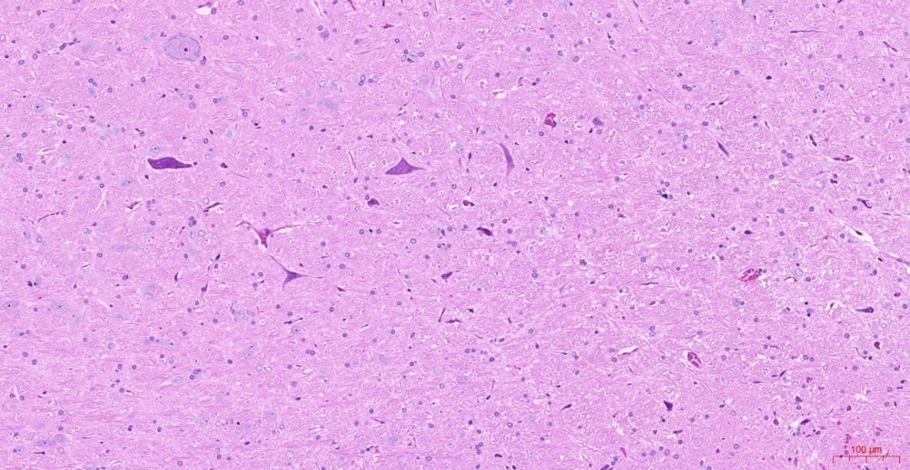

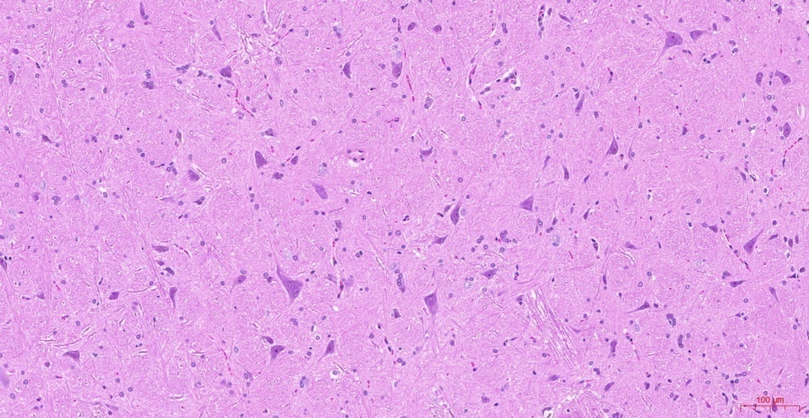

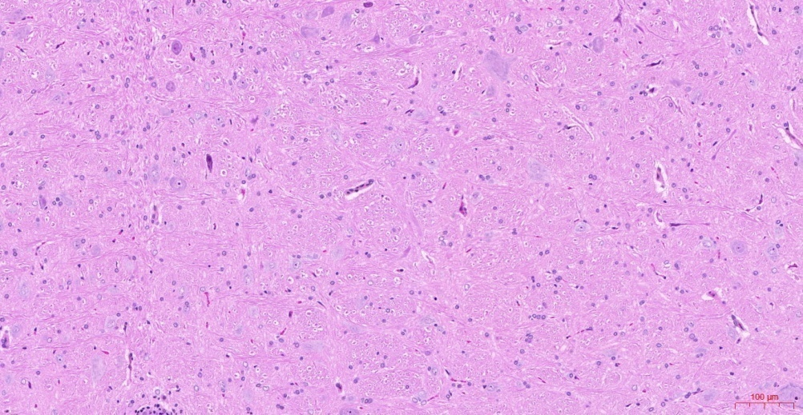

图2 三组组织HE染色代表性图像

注：图像依次为伪手术组、模型组及复位组；各图比例尺100 μm。单一代表性视野用于形态展示，不用于推断各组细胞数量。

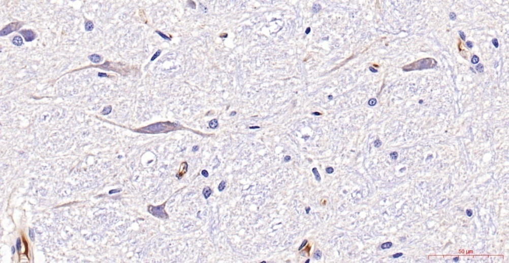

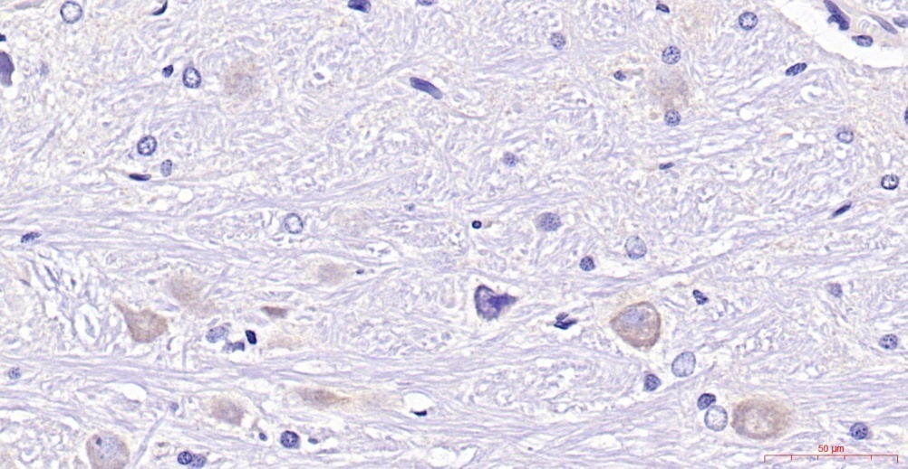

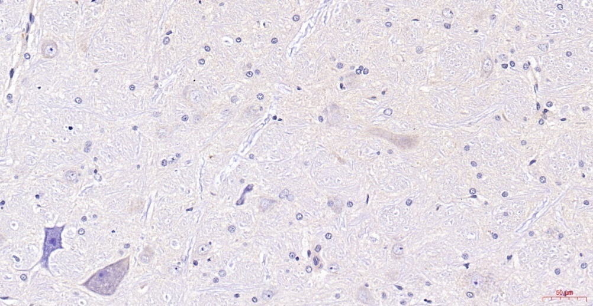

图3 三组AT1R免疫组化代表性图像

注：图像依次为伪手术组、模型组及复位组；各图比例尺50 μm。棕色为免疫反应信号；染色强度的组间比较需控制切片、染色批次及图像采集条件。

AT1R免疫荧光图像中，DAPI核染色为蓝色，AT1R相关免疫信号为红色，三组均展示对应的核染色、靶标信号及合并图（图4）。未进行神经元特异性标记共染时，不能把AT1R阳性信号直接表述为“AT1R阳性神经元数量增加”。

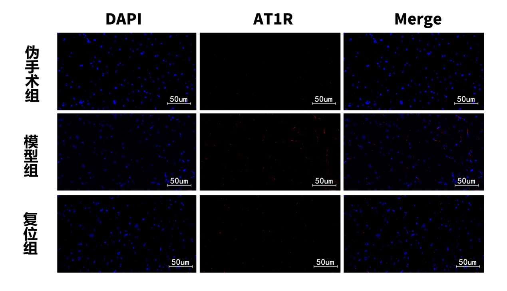

图4 三组AT1R免疫荧光代表性图像

注：行依次为伪手术组、模型组和复位组，列依次为DAPI、AT1R和Merge；各视野比例尺50 μm。保留原图显示信息，未调整荧光亮度或对比度。

## 3 讨论

### 3.1 异物置入与血压变化的关系

本研究中，模型组在关节间隙置入固定物后血压均值逐步上升，取出固定物后复位组血压均值呈下降趋势。这一时间顺序与既往异物置入模型的观察方向相符[1]，支持颈部局部处理与血压表型存在联系。不过，固定物除影响关节结构外，还可能引起局部组织损伤、炎症、疼痛或机械牵拉。伪手术控制了初次手术入路，但若缺少病程相同的第二次伪手术对照，就难以完全排除再次麻醉、组织操作及时间因素对血压变化的影响。

因此，结果支持“异物置入及取出伴随血压变化”的判断，其中特定结构变化的贡献仍需结合可靠的影像定量和对照设计评估。外科取出固定物与临床手法整复在处理方式和生理影响上不同，本研究不能直接用来证明手法治疗高血压的疗效。

### 3.2 心率与HRV对自主神经变化的提示

模型组心率均值较高，同时SDNN、RMSSD和TP均值较低，提示心搏间期波动的部分特征发生变化。由于不同HRV指标反映的生理成分不同，不能用单一“增高”或“降低”概括全部HRV结果。复位组部分时域指标及TP的均值回升，而LF/HF均值仍较高，说明各指标的变化并非完全一致。

大鼠的心率与呼吸频率高于人类，频域分析需要考虑物种、呼吸和记录条件。已有大鼠研究采用LF 0.2—0.75 Hz和HF 0.75—2.5 Hz等频段[3]，与本研究原分析设置不同。这里不能直接套用人类频段的生理解释，也不能仅凭LF/HF升高认定交感神经放电增强。100 Hz采样、麻醉状态和较短记录时间也可能影响R-R间期及频谱估计。对交感功能的判断应结合适当的大鼠HRV重分析和直接神经活动记录。

### 3.3 血清递质及氧化应激指标的解释

模型组血清ACh均值下降，AngⅡ均值上升，取出异物后两项均值向伪手术组方向变化。ACh浓度降低不足以独立判断整个副交感神经系统的活动水平。血清NE均值较高，但个体离散程度大；没有与血压或神经放电配对的个体分析时，不能把血清递质浓度直接换算为交感神经兴奋程度。

SOD活性降低与MDA、ROS相关信号升高共同提示外周氧化应激相关状态改变。复位组部分指标呈反向变化，提示这一状态可能与模型处理相关。但是血清ROS探针信号既不区分所有活性氧种类，也不定位到RVLM，因此不能据此证明RVLM内由NOX1或NOX4产生的ROS增加。外周AngⅡ与RVLM AT1R表达同时变化，同样不构成两者在同一动物中的相关性或循环AngⅡ直接作用于该脑区的证据。

### 3.4 RVLM相关分子表达与机制假说

逐动物归一化及多重比较校正后，模型组六项靶标表达量均高于伪手术组，复位后其中五项低于模型组。ROCK2虽然均值下降，但在18次比较统一校正后未达到显著性；复位组NOX1与伪手术组的比较也未达到校正后显著性。这两项结果说明各靶标对异物取出的变化幅度及统计证据并不相同，不能概括为全部表达量显著下降或已恢复至对照水平。

在其他高血压动物模型中，RVLM局部ROS干预可改变血压及交感活动[4]，为研究脑干氧化应激与血压调节的联系提供了功能性依据。脑干Rho/Rho激酶通路的干预研究也提示该通路可参与中枢性血压调节；例如在孤束核进行Rho激酶抑制，可改变血压和交感相关指标[5]。这些研究为本研究选择AT1R、NOX及RhoA/ROCK指标提供背景，但其动物模型、处理部位及因果证据不能直接移用于本模型。

RT-qPCR与Western blot检测的是不同层级的信息，分别反映转录本丰度和蛋白免疫反应信号，两者并不重复。总RhoA及ROCK蛋白表达增加，不等于RhoA的GTP结合状态或ROCK激酶活性增强；NOX表达增加也不等于其酶活性或局部ROS生成速率增加。要验证“AT1R—NOX/ROS—RhoA/ROCK—交感输出—血压”这一顺序关系，需要在同一模型中开展受体阻断、通路抑制、活动状态检测及直接交感记录等实验。

SCG是颈部自主神经结构，但外周交感节后纤维与RVLM之间不能被简化为已证实的逆向兴奋传导。本研究的分子表达及血清结果尚不足以证明SCG介导了RVLM的变化。

### 3.5 组织学观察的证据范围

HE、免疫组化及免疫荧光为观察组织形态和靶标分布提供了补充信息。代表性图像不能替代按动物汇总、盲法选取视野和统一采集条件下的定量分析。HE染色不足以可靠地完成尼氏体含量评价，AT1R单标记也不能确认所有阳性细胞为神经元。因此，本研究对组织学结果作形态及免疫信号展示，不据此判定神经元丢失或炎症细胞浸润的组间差异。

### 3.6 研究局限与后续验证

本研究局限首先在于模型特异性与时序对照。固定物置入可能同时改变局部机械状态和组织损伤反应，复位组又处于更长病程，后续需要设置病程匹配的持续模型组及第二次伪手术组，以识别异物取出本身的作用。模型筛选、动物损失和各终点样本流向也会影响结果的代表性。

其次，RT-qPCR每组样本量为6，部分靶标Ct值较高，单次测定缺少复孔对技术误差的评估。相同扩增效率和内参稳定性的假设影响相对表达结果，统计显著性不能替代检测特异性、扩增曲线、熔解曲线及阴性对照的质量验证。Western blot每组3只动物的定量证据则依赖完整膜、原始曝光及逐动物灰度记录，代表性图像本身不足以完成这一验证。

最后，本研究以表达变化和血清指标为主要证据，直接交感输出、RVLM定位和通路活性尚需与功能性干预共同验证。研究结果适用于当前动物处理及观察条件，对人类高血压发生机制和临床治疗效果的外推应保持谨慎。

## 4 结论

寰枢关节间隙异物置入后的模型大鼠血压均值逐步升高，外科取出异物后血压均值下降，并伴随部分血清递质及氧化应激相关指标向伪手术组方向变化。

在相同且近似100%扩增效率的假设下，逐动物配对Ct分析提示模型组RVLM区域AT1R、NOX1、NOX4、RhoA、ROCK1及ROCK2转录本表达升高。复位后AT1R、NOX1、NOX4、RhoA及ROCK1较模型组降低；ROCK2的下降未达到多重比较校正后的显著性。Western blot及组织免疫染色仅支持相应靶标的代表性信号观察。

现有结果为进一步研究AT1R、NOX及RhoA/ROCK参与的交感相关机制提供线索，尚不能证明SCG至RVLM的传导关系、特定信号通路的因果介导作用或临床手法复位的降压疗效。

## 参考文献

[1] He ZB, Lv YK, Li H, et al. Atlantoaxial Misalignment Causes High Blood Pressure in Rats: A Novel Hypertension Model. Biomed Res Int. 2017;2017:5986957. DOI: [10.1155/2017/5986957](https://doi.org/10.1155/2017/5986957).

[2] Livak KJ, Schmittgen TD. Analysis of relative gene expression data using real-time quantitative PCR and the 2(-Delta Delta C(T)) Method. Methods. 2001;25(4):402–408. DOI: [10.1006/meth.2001.1262](https://doi.org/10.1006/meth.2001.1262).

[3] Carnevali L, Barbetti M, Statello R, Williams DP, Thayer JF, Sgoifo A. Sex differences in heart rate and heart rate variability in rats: Implications for translational research. Front Physiol. 2023;14:1170320. DOI: [10.3389/fphys.2023.1170320](https://doi.org/10.3389/fphys.2023.1170320).

[4] Kishi T, Hirooka Y, Kimura Y, Ito K, Shimokawa H, Takeshita A. Increased reactive oxygen species in rostral ventrolateral medulla contribute to neural mechanisms of hypertension in stroke-prone spontaneously hypertensive rats. Circulation. 2004;109(19):2357–2362. DOI: [10.1161/01.CIR.0000128695.49900.12](https://doi.org/10.1161/01.CIR.0000128695.49900.12).

[5] Ito K, Hirooka Y, Sakai K, Kishi T, Kaibuchi K, Shimokawa H, Takeshita A. Rho/Rho-kinase pathway in brain stem contributes to blood pressure regulation via sympathetic nervous system: possible involvement in neural mechanisms of hypertension. Circ Res. 2003;92(12):1337–1343. DOI: [10.1161/01.RES.0000079941.59846.D4](https://doi.org/10.1161/01.RES.0000079941.59846.D4).
